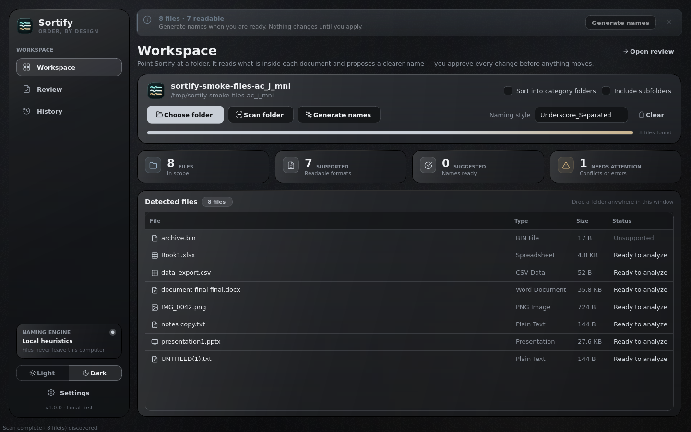
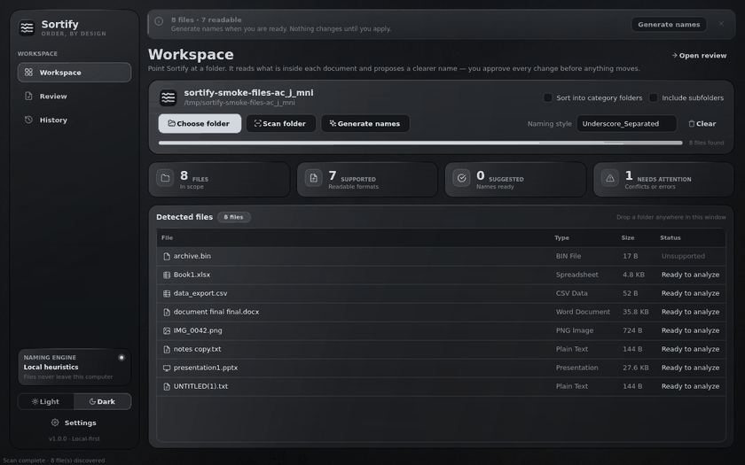
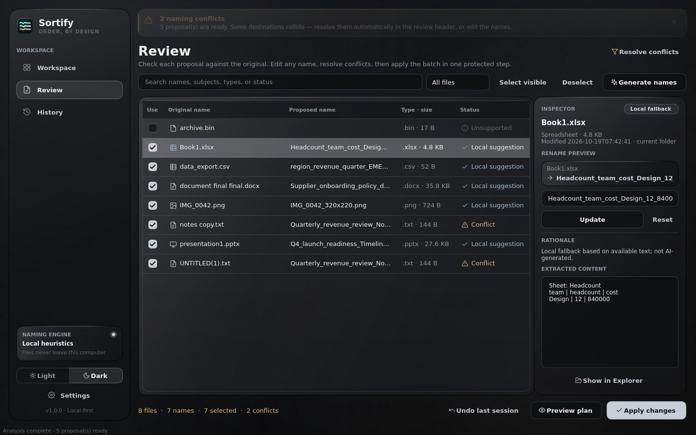
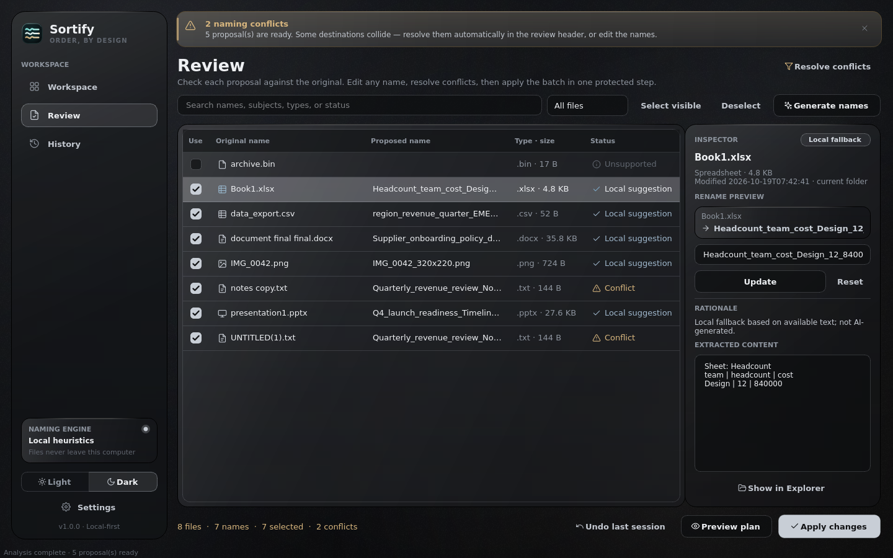
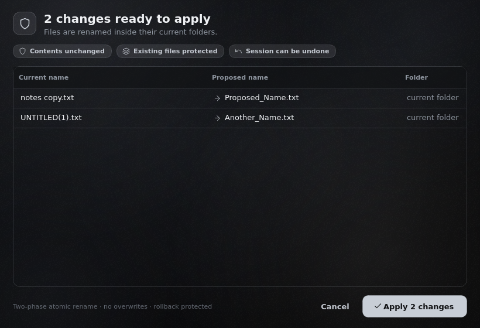
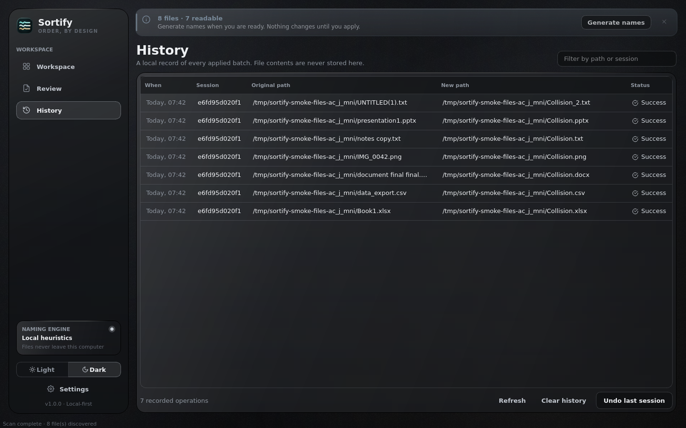
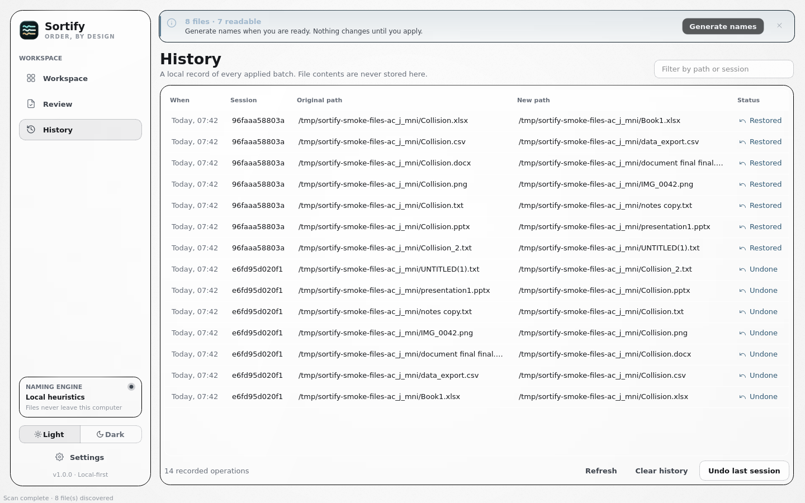

<div align="center">

<picture>
  <source media="(prefers-color-scheme: dark)" srcset="assets/sortify-logo.svg">
  
</picture>

### Name every file by what is inside it.

Sortify reads your documents, spreadsheets, slides, and images, proposes clear filenames
from their contents, and renames them **only after you approve each change**. Every applied
batch can be undone.

[](https://github.com/hmmlavi/sortify-desktop/actions/workflows/ci.yml)


-41CD52?logo=qt&logoColor=white)

<br>



<sub>Headless render of the app's own widgets (offscreen Qt, Linux fonts). Sample files were generated by the GUI smoke test.</sub>

</div>

---

## Features

- **Reads inside files.** Bounded excerpts from PDF, Word, Excel, PowerPoint, text, CSV, JSON, YAML, HTML, and image metadata.
- **Two naming engines.** An offline *local heuristic* engine (the default), or any OpenAI-compatible endpoint you configure, with explicit consent.
- **You approve every change.** Edit any proposal inline, resolve duplicate destinations, and check the exact before-and-after table in *Preview plan*.
- **Safe renames.** Collisions are detected before the batch starts. Files are never overwritten, and failures are reported per file.
- **Undo.** Each applied batch is recorded in a local SQLite history. *Undo last session* restores the original names when that is still safe.
- **Dark and light themes.** A smoked-glass interface in charcoal and silver, with a matching light "Smoke" theme.

<div align="center">

<br>
<sub>Workflow from the GUI smoke test, rendered headless.</sub>
</div>

## Gallery

<table>
<tr>
<td width="50%"><br><sub><b>Review.</b> Proposals, conflicts, and status side by side.</sub></td>
<td width="50%"><br><sub><b>Inspector.</b> Edit one file's name, with its rationale and extracted text.</sub></td>
</tr>
<tr>
<td width="50%"><br><sub><b>Preview plan.</b> The exact plan that will run.</sub></td>
<td width="50%"><br><sub><b>History.</b> Applied and undone batches, by session.</sub></td>
</tr>
<tr>
<td width="50%"><br><sub><b>Smoke theme.</b> The light appearance.</sub></td>
<td width="50%"></td>
</tr>
</table>

## Downloads

Release **v1.0.0** is built by GitHub Actions on a Windows runner from the tagged commit.

| File | What it is |
| --- | --- |
| [`Sortify-Setup-1.0.0.exe`](https://github.com/hmmlavi/sortify-desktop/releases/download/v1.0.0/Sortify-Setup-1.0.0.exe) | Installer. Per-user, no administrator rights, Start Menu entry, and an uninstaller that keeps your data by default. |
| [`Sortify-1.0.0-windows-x64-portable.zip`](https://github.com/hmmlavi/sortify-desktop/releases/download/v1.0.0/Sortify-1.0.0-windows-x64-portable.zip) | Portable build. Unzip anywhere and run `Sortify.exe`. Bundles its own Python and Qt. |
| [`Sortify-1.0.0-windows-x64-standalone.zip`](https://github.com/hmmlavi/sortify-desktop/releases/download/v1.0.0/Sortify-1.0.0-windows-x64-standalone.zip) | PyInstaller folder build. Unzip, then run `Sortify.exe` inside it. |
| [`SHA256SUMS.txt`](https://github.com/hmmlavi/sortify-desktop/releases/download/v1.0.0/SHA256SUMS.txt) | SHA-256 checksums of the three files above. |

All release files are on the [Releases page](https://github.com/hmmlavi/sortify-desktop/releases/tag/v1.0.0). Check a download before running it:

```powershell
Get-FileHash .\Sortify-Setup-1.0.0.exe -Algorithm SHA256
```

The builds are **not code-signed**, so Windows SmartScreen may show *"Windows protected your PC"*. Compare the hash with `SHA256SUMS.txt`, then choose **More info → Run anyway**.

**Requirements:** Windows 10 or 11, 64-bit. About 120 MB of disk space for the portable build, plus a few MB for settings and history.

## Quick start

1. Install with **Sortify-Setup-1.0.0.exe**, or unzip the portable ZIP and run `Sortify.exe`.
2. Click **Choose folder** (or drop a folder on the window), then **Scan folder**.
3. Click **Generate names**, review the proposals, then **Preview plan** → **Apply changes**.
4. Changed your mind? Open **History** and choose **Undo last session**.

No account, login, or API key is needed. Settings and history are stored in `%APPDATA%\Sortify\`.

### Keyboard shortcuts

| Action | Shortcut | Action | Shortcut |
| --- | --- | --- | --- |
| Open folder | `Ctrl+O` | Workspace / Review / History | `Ctrl+1` / `Ctrl+2` / `Ctrl+3` |
| Scan folder | `F5` | Preview plan | `Ctrl+P` |
| Generate names | `Ctrl+Return` | Toggle light / dark | `Ctrl+T` |
| Settings | `Ctrl+,` | |

### Supported files

- **Documents:** `.pdf` `.docx` `.rtf` `.html` `.htm`
- **Notes and data:** `.txt` `.md` `.rst` `.log` `.csv` `.tsv` `.xlsx` `.json` `.yaml` `.yml`
- **Presentations:** `.pptx`
- **Images:** `.jpg` `.jpeg` `.png` `.webp` `.gif` `.bmp` `.tiff`

Limits: password-protected files are reported as unreadable. Image-only PDFs fall back to filename and metadata, because no OCR is bundled. Files over 100 MB and images over 64 megapixels are skipped. Unsupported files are listed as *Unsupported* and never renamed.

## Privacy and security

- **Local by default.** The offline engine sends nothing anywhere.
- **Explicit AI consent.** External AI is used only after you tick the consent box. Only bounded excerpts from selected files are sent, and only to the endpoint you configure.
- **API keys stay in the OS keyring** (Windows Credential Manager). They are never written to `settings.json` or logs.
- **Contents are never modified.** Only file names change, and folders if you ask for category folders.
- **Symbolic links are skipped** by default, so a scan stays inside the folder you chose.

## Troubleshooting

- **The window does not appear.** Read `%APPDATA%\Sortify\startup-error.log`, or run `Sortify.exe --diagnose` from a terminal to print a JSON health report.
- **Windows protected your PC.** Expected for unsigned builds. See [Downloads](#downloads).
- **Corrupt history or settings.** Sortify moves the damaged file to a timestamped `.bak` copy and starts clean. Nothing is deleted.

## Developer guide

### Run from source

```powershell
py -3.12 -m venv .venv
.\.venv\Scripts\Activate.ps1
pip install -r requirements.txt
python main.py
```

`requirements-lock.txt` pins exact versions. Python 3.11 or newer is required.

### Test and lint

```powershell
python -m unittest discover -s tests -v
python -m pytest -v
python -m ruff check app main.py tests packaging
python main.py --diagnose
```

`packaging/gui_smoke_test.py` drives the real windows through scan, edit, apply, undo, and dialogs. It runs headless with `QT_QPA_PLATFORM=offscreen`:

```powershell
python packaging\gui_smoke_test.py --output smoke
```

### Build the Windows packages

- **Standalone folder and installer** (Windows, with Inno Setup 6): `packaging\build_windows.bat`. Outputs `dist\Sortify\` and `release\Sortify-Setup-1.0.0.exe`.
- **Portable ZIP** (Linux or Windows): `packaging/prepare_portable_inputs.py`, then `packaging/build_portable_windows.py`. See the comments at the top of each script.

### Layout

```text
app/            application code: ui/, core/ (scan, rename, history), ai/, workers/
assets/         logo and icon sources
docs/assets/    README screenshots, demo GIF, and diagrams
packaging/      Windows build, portable builder, installer, release verification
release/        checksums and release notes
tests/          unit and integration tests
.github/        CI workflow: tests, Windows builds, and tagged release publishing
```

### Continuous integration

`.github/workflows/ci.yml` runs on pushes to `main` and version tags (`v*`). It runs lint and tests on Ubuntu and Windows, builds the portable ZIP, builds the standalone folder and installer on Windows, installs the installer silently, and runs the portable build. Pushing a version tag after these checks pass publishes a GitHub Release.

## License

MIT. See [LICENSE](LICENSE). © 2026 Sortify contributors.
